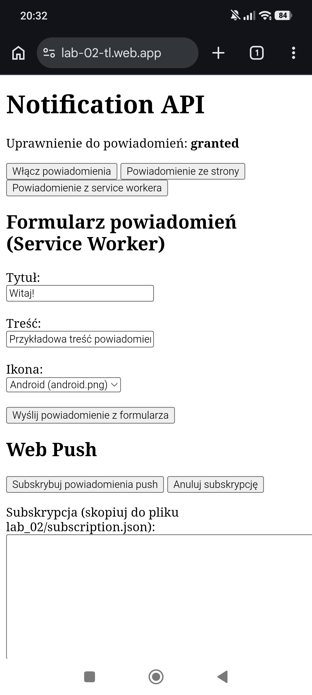

# Lab 02 – Powiadomienia i Web Push

## Co zostało zrealizowane
Kilka zdań: aplikacja PWA z trzema rodzajami powiadomień, formularz
(tytuł, treść, ikona) wyświetlany przez service workera, walidacja pustego
tytułu, obsługa Web Push (subskrypcja, anulowanie, wysyłka skryptem send-push.mjs).

## Uruchomienie
- Lokalnie: `cd public` → `npx serve` → http://localhost:3000
- Web Push: `npm install`, `node generate-keys.mjs`, wklej klucz publiczny do
  public/notification.js, zapisz subskrypcję do subscription.json,
  wyślij: `node send-push.mjs "Tytuł" "Treść"`
- Opublikowana aplikacja: https://lab-02-tl.web.app

## Zrzut ekranu

