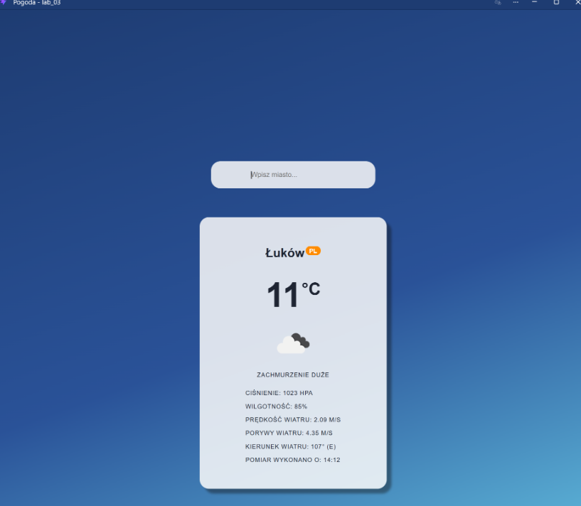
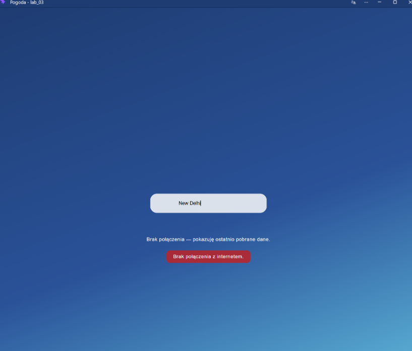
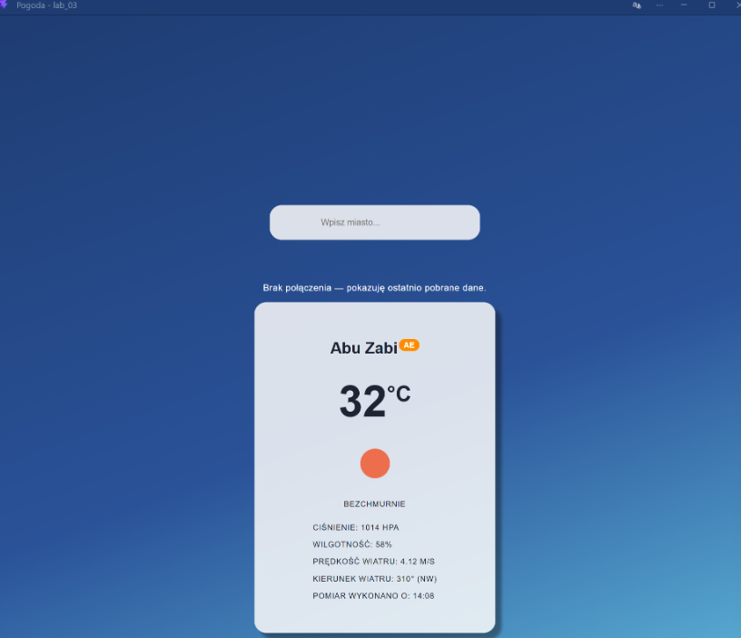

# Aplikacja Pogodowa PWA

Aplikacja napisana w React i Vite, pobierająca dane pogodowe z OpenWeatherMap. Obsługuje tryb offline (PWA) z wykorzystaniem Service Workera, pokazując ostatnio pobraną pogodę w przypadku braku połączenia z siecią.

## Uruchomienie aplikacji

Service worker działa poprawnie tylko w wersji produkcyjnej, dlatego aplikację należy zbudować i uruchomić w trybie podglądu:

```bash
npm install
npm run build
npm run preview
```
Po wykonaniu poleceń aplikacja będzie dostępna pod adresem http://localhost:4173/.





