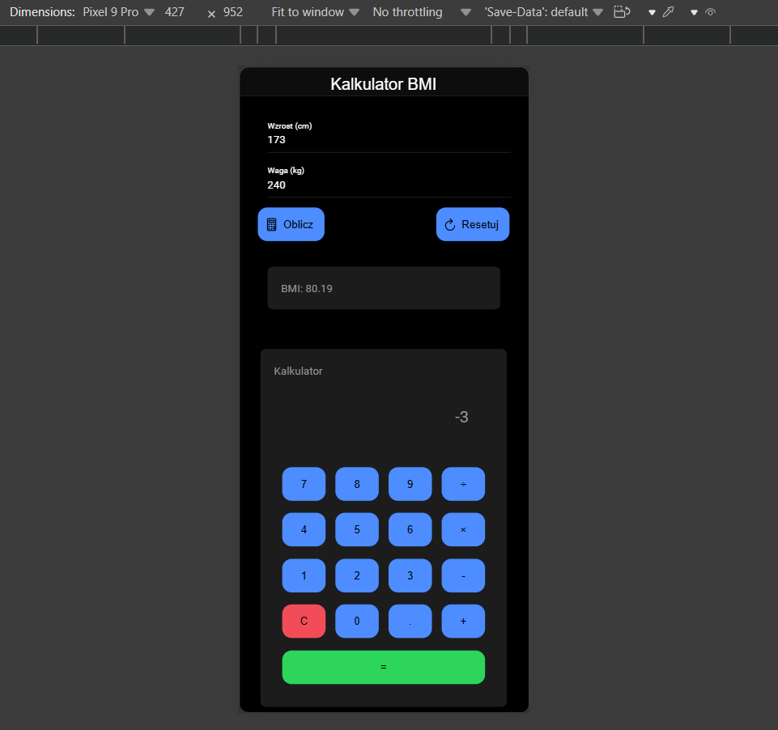

# Lab 04 – Kalkulator BMI i kalkulator

## Uruchomienie aplikacji

Aby uruchomić aplikację, należy:

1. Otworzyć terminal w folderze projektu.
2. Wpisać komendę `npm install`, aby zainstalować potrzebne pakiety.
3. Następnie wpisać `ionic serve`.
4. Aplikacja otworzy się w przeglądarce.

## Zadanie 1 – Kalkulator BMI

Kalkulator BMI pozwala obliczyć BMI na podstawie wzrostu i wagi. Po wpisaniu danych i kliknięciu przycisku „Oblicz” wyświetla się wynik. Przycisk „Resetuj” czyści wpisane dane.

**Zrzut ekranu – kalkulator BMI z wynikiem i kalkulator też (widok telefonu):**

## Zadanie 3 – Kalkulator

Kalkulator pozwala wykonywać podstawowe działania matematyczne: dodawanie, odejmowanie, mnożenie i dzielenie. Posiada również przycisk czyszczenia oraz obsługuje liczby dziesiętne i liczenie łańcuchowe. Funkcja wybierzDzialanie zapamiętuje wybrany operator i pierwszą liczbę. Jeśli wcześniej było już jakieś działanie i wpisaliśmy drugą liczbę, to najpierw wykonuje poprzednie obliczenie za pomocą switch. Następnie zapisuje wynik jako nową pierwszą liczbę. Dzięki temu kalkulator obsługuje liczenie łańcuchowe.

