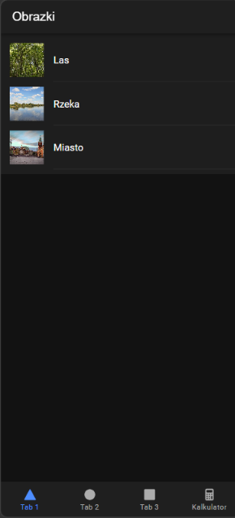
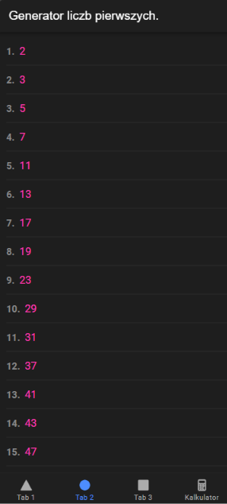
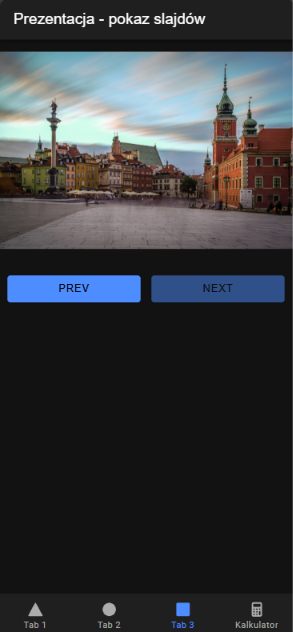
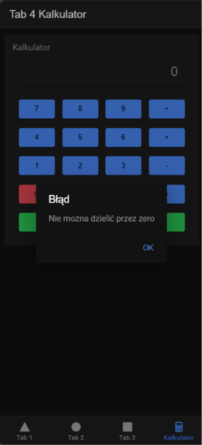

# Laboratorium 5 - Aplikacja Ionic

## Instrukcja uruchomienia

Aby uruchomić aplikację lokalnie, otwórz terminal w folderze projektu i wykonaj poniższe polecenia:

1. Zainstaluj wszystkie wymagane pakiety:
   ```bash
   npm install
   ```

2. Uruchom aplikację w przeglądarce:
   ```bash
   ionic serve
   ```

---

## Zrzuty ekranu (widok telefonu)

### 1. Lista obrazków


### 2. Lista liczb pierwszych


### 3. Pokaz slajdów


### 4. Kalkulator z alertem dzielenia przez zero

