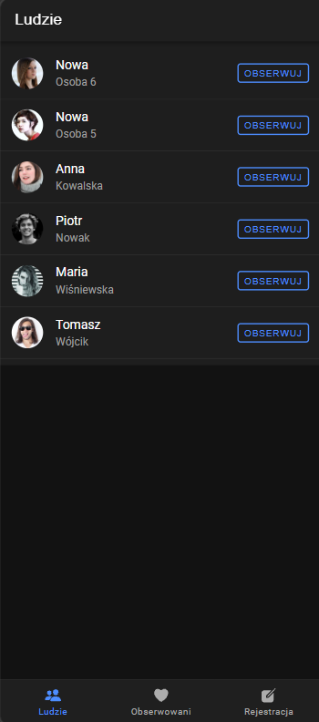
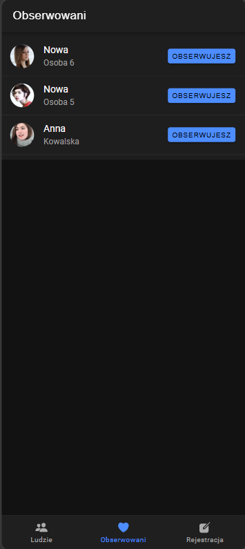
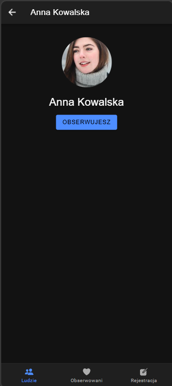
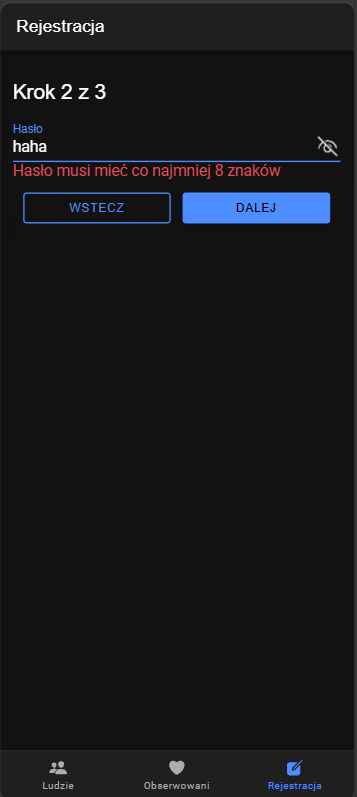
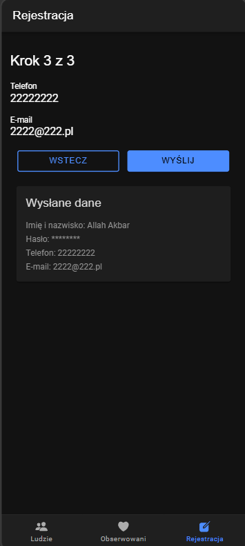

# Lab 06 – Nawigacja, wspólny stan i formularze w Ionic React

Aplikacja z zakładkami zbudowana w Ionic React, wykorzystująca:
- **Zustand** – wspólny stan aplikacji (lista osób i obserwowanie),
- **React Router** – nawigacja z parametrem (`/tab1/:id`) i widok szczegółów osoby,
- **IonRefresher** – odświeżanie listy gestem *pull-to-refresh*,
- **react-hook-form + Swiper** – formularz krokowy (3 kroki) z walidacją i podsumowaniem danych.

## Uruchomienie aplikacji

1. Przejdź do folderu projektu:
   ```bash
   cd lab_06

## Zrzuty ekranu:
### Lista osób


### Lista obserwowanych


### Widok szczegółów osoby


### Formularz z komunikatem błędu


### Karta z wysłanymi danymi
